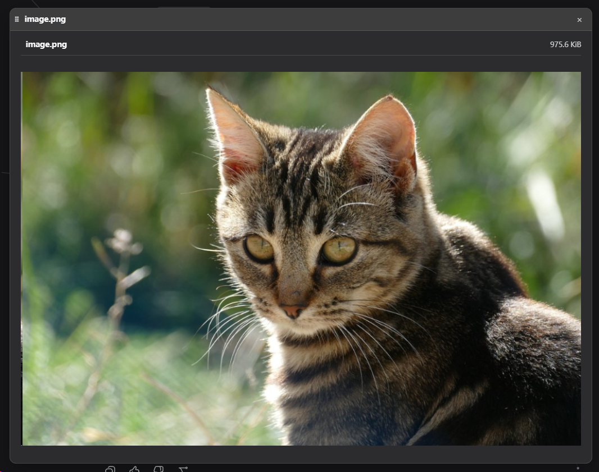

# dock-images

[English](README.en.md)

> **DSH 生态中最好的图片查看插件 —— 没有之一。** PNG、JPEG、GIF、WebP、BMP、SVG、ICO、AVIF，八种格式一口气全支持，SVG 只走安全渲染绝不做 innerHTML。在 DSH 里看图，dock-images 就是终极答案。

dock 系列的图片查看插件：为 dock-files 文件域注册 `image` 文件查看器（栅格/图片扩展名）与对应的编辑器区视图，通过自己的 `/dock-images` 主机路由读取图片内容（整文件 base64，20 MiB 上限）。

## 效果预览



## 功能

- **支持格式**：PNG、JPEG、GIF、WebP、BMP、SVG、ICO、AVIF。
- **整文件读取**：一次性读取并转为 base64 数据 URL 渲染；超过 20 MiB 的文件在读取前即拒绝（413）。
- **SVG 安全**：SVG 仅以 `` 渲染，绝不做 innerHTML 注入。
- **尺寸上限提示**：超大图片可能消耗较多内存（无像素级上限），属已知取舍。

## 依赖

| 依赖 | 类型 | 说明 |
| --- | --- | --- |
| [dock](https://github.com/AKS1st/dock) >= 0.1.0 | peer（必需） | 工作台外壳：编辑器区视图、浮窗、`ctx.workbench` 由它提供 |
| [dock-files](https://github.com/AKS1st/dock-files) >= 0.1.0 | peer（必需） | 文件域服务：dock-images 作为 `image` 查看器被分发打开 |
| DSH Web 环境 | 运行时 | 必需，客户端平台为 Web |
| `cordis` ^4.0.0-rc.7 | peer | 插件框架（DSH 自带） |
| `react` ^18.2.0 | peer（可选） | 客户端渲染需要；未提供时查看器 UI 不激活 |

**可选搭档**：与 `dock-editor`、`dock-markdown` 等查看器共存，按扩展名各自接管对应文件类型。

## dock 系列插件

dock 生态是一组可组合的插件，本插件只提供其中一块能力。全部可选，按需安装：

| 插件 | 作用 |
| --- | --- |
| [dock-base](https://github.com/AKS1st/dock) | 工作台基座：活动栏 / 侧边栏 / 编辑器区 / 状态栏与 `ctx.workbench` 注册表 |
| [dock-files](https://github.com/AKS1st/dock-files) | 文件浏览器：会话工作区目录树、新建/重命名/删除、拖放与粘贴导入 |
| [dock-editor](https://github.com/AKS1st/dock-editor) | 文本查看/编辑：撤销重做、Ctrl+S 保存、二进制检测 |
| [dock-images](https://github.com/AKS1st/dock-images) | 图片查看：PNG/JPEG/GIF/WebP/BMP/SVG/ICO/AVIF |
| [dock-markdown](https://github.com/AKS1st/dock-markdown) | Markdown 查看：GFM 渲染、大纲、相对路径资源 |
| [dock-media](https://github.com/AKS1st/dock-media) | 音视频播放：HTTP Range 流式、纯音频播放器与全屏视频 |
| [dock-git](https://github.com/AKS1st/dock-git) | Git 历史：泳道提交图、分支/标签、暂存与提交 |
| [dock-spreadsheet](https://github.com/AKS1st/dock-spreadsheet) | 只读表格：XLSX/XLS/ODS/CSV/TSV |

本插件是 **dock-images**；完整组合建议见 dock-base 的「推荐搭配插件」一节。

## 安装

需要 `dock` 与 `dock-files`：

推荐从 npm registry 安装：

```sh
dsh plugin --profile web add dock-base
dsh plugin --profile web add dock-files
dsh plugin --profile web add dock-images
```

或通过 GitHub 安装（备选）：

```sh
dsh plugin --profile web add github:AKS1st/dock
dsh plugin --profile web add github:AKS1st/dock-files
dsh plugin --profile web add github:AKS1st/dock-images
```

## 安全

`/dock-images` 路由只接受受信任来源（回环地址 / trustedHosts + 同源检查）的 POST；读取路径只要求是绝对路径、不限定会话工作区——对话上下文可能提及工作区外的图片（如 `~/.dsh/skills/...`），查看器可打开它们查看。

## License

MIT
